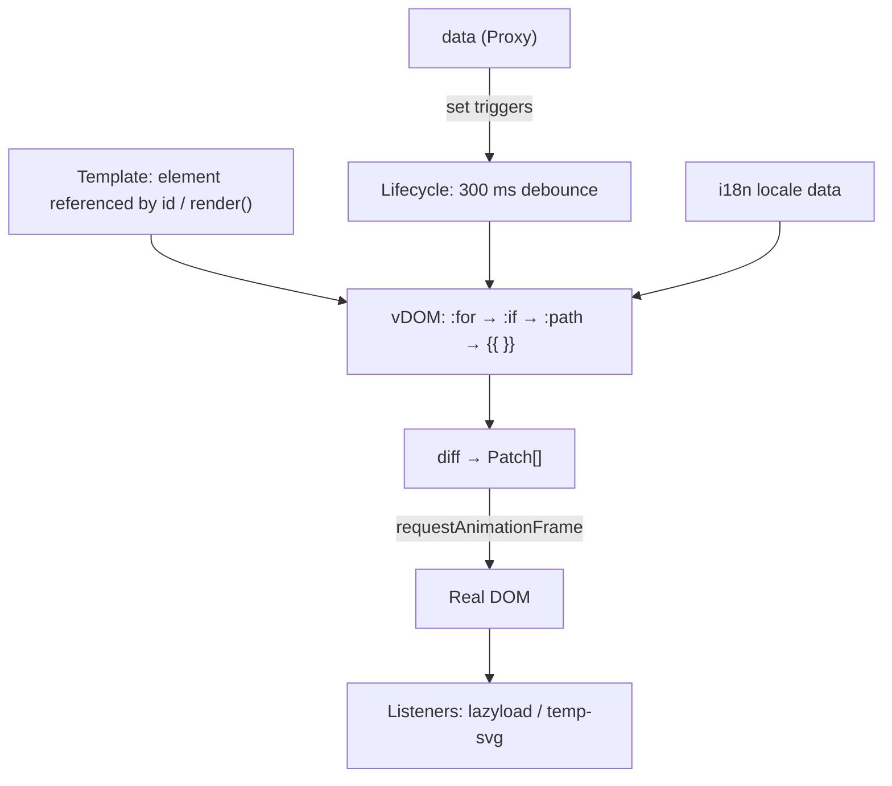

# Architecture

This page shows how QuickUI's modules are layered and where each one lives in the source, in a single overview diagram, plus how QuickUI relates to similar libraries.

## System Overview

## Layers

| Layer | Source | Responsibility |
|---|---|---|
| Entry | `src/model` (`QUI.ts`) | Creates the instance, loads i18n, wraps reactive data, applies patches, handles attribute and event binding |
| Virtual DOM | `src/model` (`vDOM.ts`) | Turns elements into `tag` / `props` / `children` / `data`, expands `:for`, `:if`, `:path`, replaces `{{ }}`, produces patches |
| Lifecycle | `src/model` (`Lifecycle.ts`) | Wraps the timing of the initial render and updates, runs `when` hooks, debounces updates by 300 ms |
| Utilities | `src/function` | `createReactiveObject`, `htmlParser`, `createElement`, `getElement`, `calc`, `dateFormat` and more |
| Listeners | `src/listener` | `IntersectionObserver`-driven image lazy loading and SVG inlining |
| Shared constants | `src/*.ts` | Global aliases, regular expressions, directive names, the effect CSS injected into the page |

`tsc` concatenates every file into one script, `src/QuickUI.debug.js`, through the `outFile` setting in `tsconfig.json`; there are no module imports. Public names are attached to the global object as `window.QUI`, `window._` and `window.$`.

## Cross-cutting Principles

| Principle | Implementation |
|---|---|
| Zero dependencies | Only native browser APIs (`Proxy`, `fetch`, `IntersectionObserver`, `requestAnimationFrame`) |
| The template is the DOM | Templates are plain HTML on the page with no compile step; every render rebuilds the vDOM from a copy of the original template |
| Data snapshots | Each render takes a snapshot with `JSON.parse(JSON.stringify(data))`, so functions, `Date` objects and `undefined` never reach the template |
| Batched writes | Patches are always applied inside `requestAnimationFrame` |

### Relation to Similar Libraries

| Library | Its stated positioning | How QuickUI relates |
|---|---|---|
| htmx | Gives HTML access to AJAX, CSS Transitions, WebSockets and Server Sent Events through attributes | Both load from one script tag and are driven by HTML attributes; htmx swaps in HTML returned by the server, while QuickUI renders on the client from a JavaScript `data` object |
| Vue.js | The Progressive JavaScript Framework | QuickUI's attribute style (`:if`, `:for`, `:model`, `@click`) reads much like Vue templates; QuickUI has no component system and uses the page's own HTML as the single template |
| Preact | Fast 3kB alternative to React with components and a virtual DOM | Both diff a virtual DOM; Preact describes UI as components, while QuickUI builds its virtual DOM from plain HTML and aligns children by index without keys |
| Alpine.js | A rugged, minimal framework for composing behavior directly in your markup | Both put behavior in markup and need no build step; QuickUI applies updates through a virtual DOM diff and ships runtime i18n, image lazy loading and SVG inlining |

## Further Reading

- Render flow in detail: [Rendering Pipeline](/rendering-pipeline)
- Change detection: [Reactive Data](/reactive-data)
- Per-module diagrams: [doc/architecture.md](https://github.com/pardnchiu/QuickUI/blob/main/doc/architecture.md)
