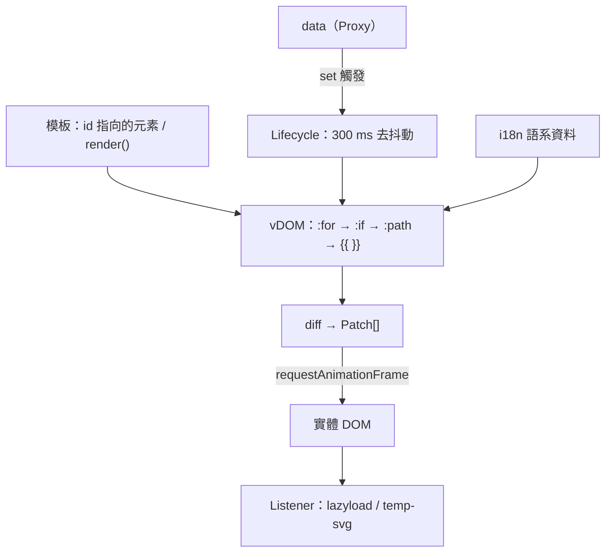

# 架構

本頁以單張概覽圖說明 QuickUI 各模組的層級關係與原始碼位置，並說明它與同類函式庫的關係。

## 系統概覽

## 分層

| 層 | 原始碼 | 職責 |
|---|---|---|
| 入口 | `src/model`（`QUI.ts`） | 建立實例、載入 i18n、包裝 reactive data、套用 Patch、處理屬性與事件綁定 |
| 虛擬 DOM | `src/model`（`vDOM.ts`） | 把元素轉成 `tag`／`props`／`children`／`data`，展開 `:for`、`:if`、`:path`，替換 `{{ }}`，產生 Patch |
| 生命週期 | `src/model`（`Lifecycle.ts`） | 包住初始渲染與更新的時序，執行 `when` 鉤子，更新去抖動 300 ms |
| 工具函式 | `src/function` | `createReactiveObject`、`htmlParser`、`createElement`、`getElement`、`calc`、`dateFormat` 等 |
| 監聽器 | `src/listener` | `IntersectionObserver` 驅動的圖片延遲載入與 SVG 內嵌 |
| 共用常數 | `src/*.ts` | 全域別名、正規表示式、指令名稱、注入頁面的效果 CSS |

所有檔案由 `tsc` 依 `tsconfig.json` 的 `outFile` 合併為單一腳本 `src/QuickUI.debug.js`，沒有模組匯入；公開名稱透過 `window.QUI`、`window._`、`window.$` 掛到全域。

## 跨切原則

| 原則 | 實作 |
|---|---|
| 零依賴 | 只用瀏覽器原生 API（`Proxy`、`fetch`、`IntersectionObserver`、`requestAnimationFrame`） |
| 模板即 DOM | 模板是頁面上的 HTML，不需要編譯步驟；每次渲染都從原始模板的複本重建 vDOM |
| 資料快照 | 每次渲染以 `JSON.parse(JSON.stringify(data))` 取快照，函式、`Date`、`undefined` 不會進入模板 |
| 批次寫入 | Patch 一律在 `requestAnimationFrame` 內套用 |

### 與同類函式庫的關係

| 函式庫 | 官方自述定位 | 與 QuickUI 的關係 |
|---|---|---|
| htmx | 以屬性讓 HTML 直接使用 AJAX、CSS Transitions、WebSockets 與 Server Sent Events | 兩者都只需一個 script 標籤、由 HTML 屬性驅動；htmx 換上伺服器回傳的 HTML，QuickUI 則在瀏覽器端依 JavaScript `data` 物件渲染 |
| Vue.js | 漸進式 JavaScript 框架 | QuickUI 的屬性寫法（`:if`、`:for`、`:model`、`@click`）與 Vue 模板相近；QuickUI 沒有元件系統，以頁面本身的 HTML 作為唯一模板 |
| Preact | 3kB 的 React 替代方案，提供元件與虛擬 DOM | 兩者都比對虛擬 DOM；Preact 以元件描述介面，QuickUI 則從純 HTML 建立虛擬 DOM，子節點依索引對齊、不使用 key |
| Alpine.js | 直接在標記中組合行為的精簡框架 | 兩者都把行為寫在標記中、不需建置步驟；QuickUI 以虛擬 DOM 差異比對套用更新，並內建執行期 i18n、圖片延遲載入與 SVG 內嵌 |

## 延伸閱讀

- 渲染流程細節：[渲染流程](/zh/rendering-pipeline)
- 資料變更偵測：[響應式資料](/zh/reactive-data)
- 各模組展開圖：[doc/architecture.zh.md](https://github.com/pardnchiu/QuickUI/blob/main/doc/architecture.zh.md)
